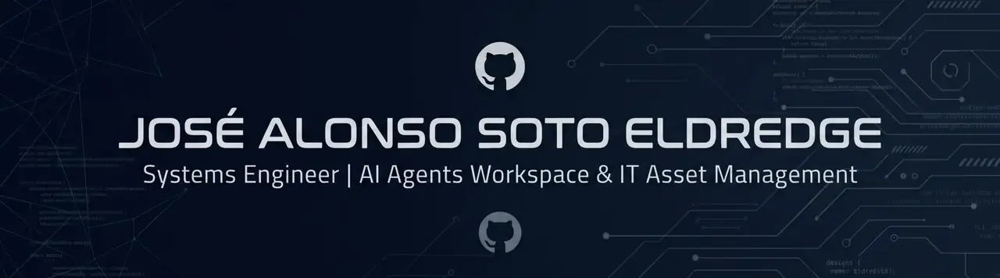

  

# José Alonso Soto Eldredge
### Ingeniero de Sistemas | IA, Infraestructura y Activos TI
*Lima, Perú*

*Building workflows for AI Agents & Enterprise IT Asset Management.*

---

## Sobre mí

Soy Ingeniero de Sistemas y trabajo en dos frentes: el diseño de ecosistemas de colaboración para agentes de Inteligencia Artificial (herramientas, servidores MCP y frameworks) y la gobernanza de activos de TI con buenas prácticas como ITIL e ISO/IEC 20000.

Combino ingeniería de software con arquitectura de sistemas e infraestructura para que tanto los sistemas inteligentes como los recursos físicos de una organización operen con orden, trazabilidad y control.

---

## Áreas de especialización

- **Inteligencia Artificial y automatización:** herramientas, plugins y servidores MCP (Model Context Protocol) que potencian a asistentes de IA (Claude Code, Cursor, Codex CLI, Gemini CLI) en entornos reales de ingeniería.
- **Gestión de activos y gobernanza TI (ITIL e ISO 20000):** plataformas para el control del ciclo de vida de activos TI, con auditoría, evidencias y flujos de trabajo por roles.
- **Backend, datos y automatización:** bases de datos relacionales y scripts de automatización para el ciclo de vida del software.

---

## Proyectos destacados

### [Agile-Forge](https://github.com/JSOTELD/Agile-Forge)
Espacio de trabajo Scrum multiagente donde desarrolladores y agentes de IA colaboran en tiempo real.
- Servidor MCP, SQLite transaccional y gobernanza humana para mantener calidad y control en flujos ágiles compartidos.

### [context-sentinel](https://github.com/JSOTELD/context-sentinel)
Gestión de contexto sin pérdidas para Claude Code.
- Checkpoints ultraligeros, protección contra la saturación de tokens y memoria persistente para sesiones largas.

### [izzi-to-work](https://github.com/JSOTELD/izzi-to-work)
Framework de 25 skills de ingeniería para asistentes de IA.
- Mutation testing, pruebas con PostgreSQL real, migraciones sin downtime y seguridad en transacciones.

### [SBN-SystemForCAATI](https://github.com/JSOTELD/SBN-SystemForCAATI)
Plataforma de gestión del ciclo de vida de activos TI físicos, basada en ITIL.
- Inventario, jornadas de verificación, evidencias y perfiles por rol para la auditoría e integridad de la infraestructura tecnológica.

---

## Tecnologías y herramientas

- **Lenguajes:** JavaScript, TypeScript, Node.js, Python (Flask), PowerShell, Bash
- **Bases de datos:** SQLite, MySQL, MariaDB, PostgreSQL
- **Control de versiones y CI/CD:** Git, GitHub Actions
- **IA y testing:** Model Context Protocol (MCP), Claude Code, Cursor, Codex CLI, Gemini CLI, Playwright

---

## Contacto

Si te interesa colaborar en herramientas para agentes de IA o en gobernanza TI, escríbeme:

- **LinkedIn:** [José Alonso Soto Eldredge](https://www.linkedin.com/in/jose-alonso-soto-eldredge-844713280/)
- **Correo:** [j.soteld@gmail.com](mailto:j.soteld@gmail.com)
